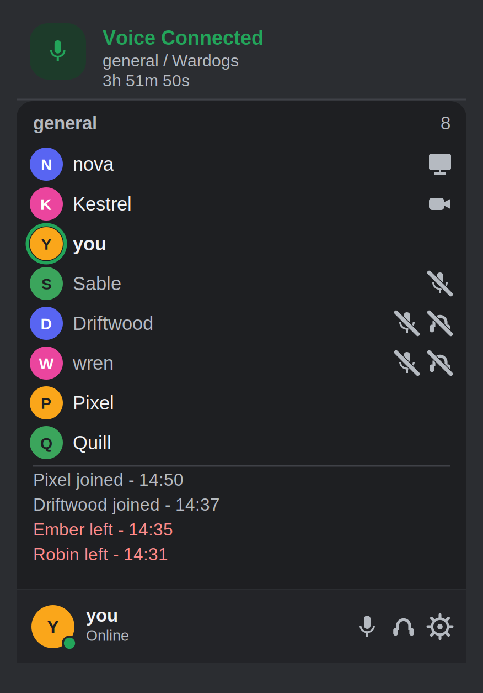

# VoiceChannelPanel

A [Vencord](https://vencord.dev) userplugin that puts a small panel above Discord's bottom-left user
area, showing **who is in the voice channel you are connected to right now** — plus a running log of
who joined and who left, with the time.



*Simulated preview, not a screenshot — it is drawn from the plugin's own layout and colours, and the names are fictional.*

Where exactly it sits: the panel docks into the bottom-left sidebar column — above Vencord's music
card while a track is playing, otherwise above the account panel itself — laid out by Discord like
any other panel. Only with neither to attach to does it become a floating panel you can drag
anywhere, with the position saved in its settings.

Built for the case where you sit in a call with friends but keep another server open: someone
quietly drops out and you would otherwise have to switch servers to find out who.

### Pop-out window

The panel header has a pop-out button that opens the panel as its own window, separate from
Discord, so it can sit over other applications. That window is frameless, transparent and always on
top by default, and keeps a live member list plus the same join/leave log. Drag it by its title row,
use the pin to toggle always-on-top while it is open, and the X to close it; it closes by itself
when you leave the channel.

Transparent and frameless are window flags applied when the window is created, so changing those two
settings needs the window reopened; always-on-top can be changed while it is open. It needs the
desktop app — popout windows do not exist in a browser.

## What it shows

- The channel name and how many people are in it, in the panel header.
- One row per member: avatar, nickname (falling back to global name, then username), and Discord-style
  icons for mute, deafen, streaming and camera — mute and deafen carry the struck-through bar.
- A log under the list: `bobby left - 14:32`, `Carol joined - 14:35`, newest first.
- A green ring around whoever is talking, matching Discord's own voice UI, with muted or deafened
  members dimmed.
- Nothing at all when you are not connected to a voice channel.

## Important: it follows *this* client only

The panel reads the voice session of the machine it is installed on
(`SelectedChannelStore.getVoiceChannelId()`). Being in a call on another device with the same
account does **not** show up here, and the panel stays hidden on a client that is not itself in a
voice channel. One client, one call, nothing else.

## Requirements

Vencord built from source. A normal Vencord install cannot load userplugins.

- git, Node.js 22+, pnpm
- Your own Vencord checkout (`git clone https://github.com/Vendicated/Vencord`)

## Install

```bash
git clone https://github.com/AkashAppari/vencord-voice-panel Vencord/src/userplugins/voiceChannelPanel
cd Vencord
pnpm install --frozen-lockfile
pnpm build
pnpm inject
```

Then restart Discord and enable **VoiceChannelPanel** in Settings → Vencord → Plugins.
After any change to the plugin, re-run `pnpm build` and restart Discord.

## Already using Vencord from the official installer

The installer ships a prebuilt Vencord, and **a prebuilt Vencord cannot load userplugins** - the plugin
folder is only read by a build compiled from source. Switching is a one-time job: `pnpm inject`
re-points your existing Discord install at the build you compile, so you don't have to uninstall
anything first, and nothing about your Discord account changes.

```bash
# needs git, Node.js 22+ and pnpm 11
git clone https://github.com/Vendicated/Vencord
cd Vencord
mkdir -p src/userplugins          # PowerShell: New-Item -ItemType Directory -Force src\userplugins
git clone https://github.com/AkashAppari/vencord-voice-panel src/userplugins/voiceChannelPanel
pnpm install --frozen-lockfile
pnpm build
pnpm inject                       # quit Discord from the tray first, not just close the window
```

Start Discord and enable **VoiceChannelPanel** in Settings → Vencord → Plugins.

Two things trip people up here:

- **Your Vencord settings don't follow you automatically.** The installer's build keeps its settings in
  `%APPDATA%\Vencord`; a source build keeps them inside the checkout, under `Vencord\settings`. To keep
  your enabled plugins, keybinds and themes, copy the `settings` folder (and `themes`, if you use it)
  from `%APPDATA%\Vencord` into `Vencord\` before you start Discord. Otherwise you begin on defaults
  and re-enable what you use.
- **Every Discord update undoes the patch.** Discord replaces its own app folder when it updates, so
  Vencord stops loading and the plugin disappears from its settings until you run `pnpm build` and
  `pnpm inject` again. Nothing is broken when that happens.

If Discord still comes up with the old prebuilt Vencord after injecting, run the official installer
once and pick Uninstall, then `pnpm inject` again.

Updating the plugin later is two pulls, a rebuild and a restart:

```bash
cd Vencord
git pull                                            # Vencord itself
git -C src/userplugins/voiceChannelPanel pull       # this plugin
pnpm install --frozen-lockfile
pnpm build
```

## Settings

| Setting | Default | What it does |
| --- | --- | --- |
| `offsetLeft` | `76` | Distance from the left edge of the window, in pixels |
| `offsetBottom` | `120` | Distance from the bottom edge, in pixels |
| `width` | `220` | Width of the panel, in pixels |
| `logSize` | `8` | How many join and leave entries to keep |
| `showJoins` | `true` | Log when someone joins as well as leaves |
| `showLog` | `true` | Show the log under the member list |
| `popoutAlwaysOnTop` | `true` | Keep the pop-out window above other windows |
| `popoutTransparent` | `true` | Give the pop-out window a transparent background |
| `popoutFrameless` | `true` | Open the pop-out window without a window frame |

## Where it sits

- **Docked (normal case).** The panel moves into Discord's bottom-left column: above the music card
  while a track is playing (`#vc-spotify-player`, the card Vencord's SpotifyControls renders above
  the account panel), otherwise above the account panel itself — the last child of the
  `[class*="panels"]` element that Vencord's own gameActivityToggle and callTimer target. Either way
  it is a real layout sibling, so that column spaces it and nothing is covered up. Matching the music
  card's geometry — flush margins, 10px top corners, a bottom hairline — makes the stack read as one.
- **Floating (nothing to dock to).** With neither present the panel falls back to a
  `position: fixed` overlay at the `offsetLeft`/`offsetBottom` settings, still draggable by its
  header and clamped to the viewport so you cannot lose it off-screen. Dragging does nothing while
  docked, because the sidebar owns the placement.

The music card only exists while a track is playing — SpotifyControls' `Player()` returns `null`
otherwise — so the panel does not check the DOM once at startup. A `MutationObserver` re-checks on
every change, throttled to a single pass per frame and idempotent so it cannot loop on its own
writes. It therefore docks as soon as that column appears, stays where it is when the card goes
away, and returns to floating only if the column itself is torn down.

## How it works, and what it does not touch

- **No patches.** The plugin declares no `patches` at all, so it never rewrites Discord's own code.
  It mounts one div into the document body and renders React into it. Docking is plain DOM work —
  the mount is moved into Discord's column, so that column lays the panel out as one of its own
  children instead of our positioning it over the app.
- **Theme colours with literal fallbacks.** The panel uses Discord's own variables
  (`--background-base-low`, `--text-normal`, …) so a docked panel matches the client's theme. Each
  carries a hardcoded fallback, because the floating panel renders outside the themed wrapper where
  those variables are undefined, and an undefined `var()` with no fallback leaves the text at the
  browser default — black, and invisible on a dark panel. That is exactly what made early builds
  look like they had no names at all.
- Member rows and the speaking ring come from `ChannelRTCStore.getParticipants()` — the same
  participant list Discord's own voice UI renders, which is why the names and the ring match it.
  When that list is unavailable it falls back to `VoiceStateStore`, so the panel cannot silently
  go blank, and it never depends on a user entity resolving before it draws a row.
- Join and leave events come from the `VOICE_STATE_UPDATES` flux event. A name resolves through
  `ChannelRTCStore.getParticipant()` → `GuildMemberStore.getNick()` → `UserStore`.
- Because it patches nothing, Discord updates will not break it the way a patch-based plugin breaks;
  only a rename inside Discord's stores would.
- Clicking anywhere outside the panel behaves normally; the panel only occupies its own card.

## Tests

`test/` renders the plugin in Node with the Vencord modules stubbed, against a real DOM, and drives
real voice-state events through it. Its 58 checks cover the member list, nickname fallback, the
mute/deafen/camera icons (including that badges carry no letter text), leave/join log text and ordering, your own transitions being ignored, dragging and its
clamping, the speaking ring and quiet state, the RTC participant list being preferred while stream
participants are not listed as members, docking when the sidebar column appears after startup,
moving above the music card once one exists, staying docked when that card goes away, dragging being
inert while docked, falling back to floating when the column is gone, the panel disappearing
when you disconnect, and the pop-out window opening with the right window flags, injecting its
stylesheet, toggling always-on-top, and closing when you disconnect.

```bash
cd test
pnpm install
node harness.mjs
```

It is a stubbed harness, not a Discord client: it proves the plugin's own logic and rendering, not
that Discord's live stores match these stubs.

## Licence

GPL-3.0-or-later, matching Vencord. Not affiliated with or endorsed by Discord Inc.
